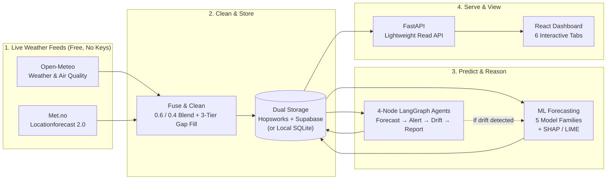

<div align="center">

# 🌤️ SkyCast (`AgentWeather`)

**An AI-powered weather & air quality forecasting system for Lahore, Pakistan**  
*Tracks live conditions, forecasts the next 24 hours, explains why predictions change, and writes tailored health & safety alerts automatically.*

[](https://github.com/ahsankamran613-svg/SkyCast/actions/workflows/ci.yml)


`Lahore, Pakistan (31.5204° N, 74.3587° E • Asia/Karachi)`

[Quick Start](#-quick-start-one-command-demo) • [How It Works](#️-how-data-flows-through-skycast) • [What It Tracks](#-what-skycast-tracks) • [AI Agents](#-the-4-ai-agents--safety-net) • [Dashboard & API](#-dashboard--api) • [Cloud Setup](#️-cloud-deployment)

</div>

---

## ✨ What is SkyCast?

Weather and air quality in **Lahore** can swing from extreme heatwaves and monsoon rain to hazardous winter smog. **SkyCast** is an end-to-end, self-running forecasting platform built to turn raw weather feeds into clear, trustworthy guidance:

- **Fetches live data for free** — combines two public weather & air quality sources (**Open-Meteo** and **Met.no**) every hour with **no API keys required**.
- **Cleans missing readings safely** — fills temporary sensor or API gaps using historical patterns (never fake zeros) and records an audit trail of every filled value.
- **Competes 5 forecasting models** — trains statistical, machine learning, and deep learning models against a 24-hour baseline and automatically promotes the most accurate winner for each metric.
- **Explains every prediction** — uses **SHAP** and **LIME** so reviewers and users can see *which weather factors* drove a forecast.
- **Thinks with 4 AI agents** — a **LangGraph** workflow turns numbers into plain-English alerts for different groups of people, watches for model accuracy drops, triggers automatic retraining when needed, and publishes daily briefings.
- **Runs anywhere** — launches in one command on your laptop with **Local SQLite Offline Mode**, or runs fully serverless in the cloud (**GitHub Actions + Supabase + Hopsworks + Vercel**).

---

## 🗺️ How Data Flows Through SkyCast



**In plain words:**
1. **Collect:** Every hour, SkyCast pulls Lahore weather and air-quality data from Open-Meteo and Met.no.
2. **Clean & Store:** It blends both feeds (`60% / 40%`), fills any missing hours smartly, and saves the clean timeline to **Supabase + Hopsworks** (or a local **SQLite** file when running offline).
3. **Forecast & Explain:** Daily (or whenever data shifts), it trains 5 model families, picks the best performer for each metric, and computes **SHAP/LIME** explanations.
4. **Analyze & Advise:** Four AI agents generate 24-hour forecasts, create health alerts, check if models are drifting out of date, and write daily weather reports.
5. **Display:** A lightweight **FastAPI** server feeds the **React** dashboard so pages load instantly without running heavy ML code during web requests.

---

## 📊 What SkyCast Tracks

SkyCast monitors **6 weather & air quality groups (8 target series)** with hazard thresholds calibrated specifically for Lahore:

| Group | Tracked Series | Unit | Lahore Alert Thresholds |
| :--- | :--- | :--- | :--- |
| **Air Quality** | `us_aqi` | US AQI (0–500) | Info `101–150` • Warning `151–200` • Critical `> 200` |
| **Temperature** | `temperature_2m` | °C | Warning `> 40°C` • Critical `> 44°C` or `< 4°C` |
| **Precipitation** | `precipitation_mm`, `precipitation_prob` | mm/h, % | Warning `> 7.5 mm/h` or `> 80%` • Critical `> 15 mm/h` |
| **Humidity** | `relative_humidity_2m` | % | Info `< 15%` • Warning `> 85%` when Temp `> 32°C` |
| **UV Index** | `uv_index` | Index (0–20) | Info `6–7` • Warning `8–10` • Critical `≥ 11` |
| **Wind** | `wind_speed_10m`, `wind_direction_10m` | km/h, ° (`sin`/`cos`) | Warning `> 40 km/h` • Critical `> 60 km/h` |

---

## 🧠 Forecasting Models & Explainability

To avoid overfitting and data leakage, SkyCast splits historical data strictly in time order (**70% train / 15% validation / 15% test**) with **24-hour buffer gaps** between splits and train-only feature scaling.

| Model Family | Type | Role |
| :--- | :--- | :--- |
| **`Naive24h`** | Persistence Baseline | Simple benchmark ("same as 24 hours ago") every model must beat |
| **`SARIMAX`** | Classical Time-Series (`statsmodels`) | Captures daily cycles and seasonal weather patterns |
| **`RandomForest`** | Tree Ensemble (`scikit-learn`) | Captures nonlinear interactions between pollutants, humidity, and wind |
| **`Ridge`** | Regularized Linear (`scikit-learn`) | Fast, stable linear baseline with lag & rolling features |
| **`LSTM`** | 2-Layer Deep Learning (`PyTorch`, CPU) | Learns multi-hour sequential patterns directly from time windows |

- **Automatic Champion Selection:** Every model is scored on **RMSE**, **MAE**, and **R²**, and the winner per metric is promoted to the model registry.
- **Explainable AI:** Global and local **SHAP** values plus local **LIME** explanations highlight which features (e.g., recent PM2.5, hour of day, wind speed) pushed a forecast up or down.
- **3-Tier Causal Gap Filling:** If an upstream feed drops out, missing values are filled using only past/local information:
  - **Tier 1 (`≤ 3h`):** Linear interpolation
  - **Tier 2 (`4–24h`):** Rolling 7-day same-hour median
  - **Tier 3 (`> 24h`):** Smoothly damped climatology  
  *(Every imputed row carries `is_imputed`, `imputation_tier`, and `imputed_columns` metadata.)*

---

## 🤖 The 4 AI Agents & Safety Net

SkyCast's decision layer is a 4-node stateful **LangGraph** workflow (`skycast/agents/`):

1. **Forecast Agent** — Runs the promoted champion models to produce the next 24-hour forecast ledger across all 8 series.
2. **Alert Agent** — Checks forecasts against Lahore's hazard rules and writes tailored guidance for **3 audiences**: *General Public*, *Sensitive Groups*, and *Outdoor Workers*.
3. **Drift Agent** — Monitors incoming data shifts (**PSI** & **KS tests**) and rolling 72-hour forecast error (**RMSE**). If performance degrades, it automatically dispatches the GitHub Actions retraining workflow.
4. **Weather Report Agent** — Runs every morning (`06:xx PKT`) or whenever an active hazard alert fires, generating a clear, human-readable Lahore weather briefing.

### Built-In LLM Fallback Chain (Zero-Crash Guarantee)

If one AI model hits a rate limit or goes offline, SkyCast automatically steps down the chain without failing the pipeline:

```text
1. Primary   → Groq API   (openai/gpt-oss-120b, reasoning_effort="low")
2. Secondary → Gemini API (gemini-3.5-flash-lite)
3. Tertiary  → Groq API   (qwen-3.8-27b, reasoning_effort="low")
4. Safety Net → Deterministic Rule-Based Templates (works 100% offline with zero LLM keys)
```

---

## 🖥️ Dashboard & API

The **React 19 + Vite 8 + Tailwind CSS v4 + shadcn/ui + Recharts 3** web app reads from a lightweight **FastAPI** layer (`api/index.py`) kept strictly isolated from heavy ML libraries so it deploys cleanly within Vercel's serverless size limits.

| Dashboard Tab | What You Can See | Backing API Endpoint |
| :--- | :--- | :--- |
| **Overview** | Live Lahore conditions, active hazard banners, daily AI weather brief | `GET /api/dashboard/overview` |
| **Forecasts** | Interactive 24-hour forecasts vs. actual observations across all 8 series | `GET /api/forecasts/history` |
| **Models** | Model leaderboard (`RMSE`, `MAE`, `R²`), champion badges, SHAP & LIME charts | `GET /api/models/leaderboard` |
| **EDA** | Historical distributions, correlations, and data-quality / imputation stats | `GET /api/eda/summary` |
| **Agents & Drift** | LangGraph execution traces, LLM fallback logs, and data/model drift scores | `GET /api/agents/logs` |
| **Technical Report** | Full rendered engineering report (`docs/FINAL_REPORT.md`) | `GET /api/report` |
| *(System Health)* | Storage mode, freshness, and service status | `GET /api/health` |

---

## 🚀 Quick Start (One-Command Demo)

You **do not** need any cloud accounts or API keys to try SkyCast. Open-Meteo and Met.no are free and key-free, and SkyCast automatically switches to **Local SQLite Offline Mode** (`.skycast_local/skycast.db`) when cloud credentials are left blank.

```bash
docker compose up --build
```

Once running, open:
- **Web Dashboard:** [http://localhost:3000](http://localhost:3000) *(Nginx serving the React app and proxying `/api/*`)*
- **API Health Check:** [http://localhost:8000/api/health](http://localhost:8000/api/health)
- **Background Scheduler:** Automatically detects a fresh start, backfills 30 days of Lahore history, trains all 5 model families + EDA + SHAP/LIME, runs the 4 AI agents, and then updates hourly and retrains daily.

To stop the containers (your local SQLite data volume is preserved):

```bash
docker compose down
```

<details>
<summary><strong>Optional Docker Environment Overrides</strong></summary>

| Variable | Default | Purpose |
| :--- | :--- | :--- |
| `SKYCAST_WEB_PORT` | `3000` | Host port for the React dashboard |
| `SKYCAST_API_PORT` | `8000` | Host port for FastAPI |
| `SKYCAST_DOCKER_BACKFILL_DAYS` | `30` | Days of Lahore history fetched on first boot |
| `SKYCAST_SCHEDULER_INTERVAL_SECONDS` | `3600` | Seconds between scheduled hourly runs |
| `SKYCAST_TRAIN_INTERVAL_HOURS` | `24` | Hours between scheduled retraining runs |

</details>

---

## 💻 Local Development (Without Docker)

### 1. Set Up Python 3.12

```bash
python -m venv .venv

# Windows (PowerShell)
.venv\Scripts\Activate.ps1
# macOS / Linux
source .venv/bin/activate

pip install --upgrade pip
pip install -r requirements-ml.txt
```

### 2. Run the Offline Data, ML & Agent Pipelines

```bash
# 1. Backfill 30 days of Lahore weather & air quality data
python -m skycast.pipelines.backfill --days 30 --offline

# 2. Compute EDA, train all 5 model families, generate SHAP/LIME, promote champions
python -m skycast.pipelines.train --offline --save-eda-json

# 3. Fetch the latest hour and run the 4-node LangGraph agent workflow
python -m skycast.pipelines.hourly_ingest --offline
```

### 3. Start the API & Frontend

```bash
# Terminal 1 — FastAPI backend (http://localhost:8000)
uvicorn api.index:app --reload --port 8000

# Terminal 2 — React Vite dev server (http://localhost:5173, proxies /api -> :8000)
cd web
npm ci
npm run dev
```

---

## ☁️ Cloud Deployment

SkyCast is designed to run on free/serverless tiers using **Supabase**, **Hopsworks**, **GitHub Actions**, and **Vercel**:

1. **Database (Supabase):** Run [`supabase/migrations/001_init_skycast.sql`](supabase/migrations/001_init_skycast.sql) in the Supabase SQL Editor.
2. **Secrets:** Copy [`.env.example`](.env.example) to `.env` for local cloud runs, and add these **GitHub Actions Repository Secrets**:
   - `HOPSWORKS_API_KEY`, `HOPSWORKS_PROJECT_NAME`
   - `SUPABASE_URL`, `SUPABASE_SERVICE_ROLE_KEY`
   - `GROQ_API_KEY`, `GEMINI_API_KEY`
   - *(Optional)* `SKYCAST_GITHUB_TOKEN` — PAT with `actions:write` if overriding the default `github.token` used by the Drift Agent to dispatch retraining.
3. **Automated Pipelines (GitHub Actions):**
   - [`.github/workflows/hourly_pipeline.yml`](.github/workflows/hourly_pipeline.yml) — Runs every hour at `:05 UTC` (`5 * * * *`) + manual `workflow_dispatch`.
   - [`.github/workflows/training_pipeline.yml`](.github/workflows/training_pipeline.yml) — Runs daily at `01:15 UTC` / `06:15 PKT` (`15 1 * * *`) + auto-triggered by the Drift Agent.
   - [`.github/workflows/ci.yml`](.github/workflows/ci.yml) — Runs `pytest`, frontend lint/typecheck/build, and `docker compose config` on every push and pull request.
4. **Web Hosting (Vercel):** Connect the repo to Vercel (`vercel.json` builds `web/dist` and deploys `api/index.py` with `docs/FINAL_REPORT.md` bundled, excluding heavy ML packages). Set `SUPABASE_URL`, `SUPABASE_SERVICE_ROLE_KEY`, and `SKYCAST_OFFLINE_MODE=false` in Vercel Project Environment Variables.

---

## 📁 Project Structure

```text
SkyCast/
├── skycast/                  # Core Python package
│   ├── config/               # Central Pydantic Settings, Lahore metric specs & hazard rules
│   ├── data/                 # Open-Meteo + Met.no ingestion, fusion, 3-tier imputation, storage
│   ├── features/             # Lag/rolling feature engineering & JSON sanitization
│   ├── ml/                   # 5 model families, chronological splits, SHAP/LIME, EDA
│   ├── agents/               # 4-node LangGraph workflow & 3-tier LLM fallback chain
│   └── pipelines/            # CLI entrypoints: backfill, train, hourly_ingest
├── api/                      # Lightweight FastAPI read layer (Vercel-safe)
├── web/                      # React 19 + Vite 8 + Tailwind CSS v4 + shadcn/ui + Recharts 3
├── supabase/migrations/      # PostgreSQL schema (001_init_skycast.sql)
├── docker/                   # Nginx reverse-proxy config (paired with root Dockerfile & docker-compose.yml)
├── .github/workflows/        # Hourly ingest, daily/drift training, and CI workflows
├── docs/                     # Full Technical Report (FINAL_REPORT.md) & EDA summary
└── tests/                    # Automated unit, contract-fake, ML, agent, and API tests
```

---

## 🧪 Verification & Testing

```bash
# Full Python test suite (storage contract fakes, ML, LangGraph agents, API, Docker/CI)
pytest -v

# Frontend lint, TypeScript typecheck, and production build
cd web && npm run lint && npm run typecheck && npm run build

# Validate Docker Compose configuration
docker compose config -q
```

---

## 📚 Documentation

- **[Technical Report (`docs/FINAL_REPORT.md`)](docs/FINAL_REPORT.md)** — Complete system write-up (also displayed inside the dashboard's **Technical report** tab).
- **[Implementation Plan (`implementation_plan.md`)](implementation_plan.md)** — Full 7-component architecture blueprint.
- **[Frontend Design Spec (`skycast-frontend-design.md`)](skycast-frontend-design.md)** — Sky Slate visual design system, typography, accessibility, and tab specs.
