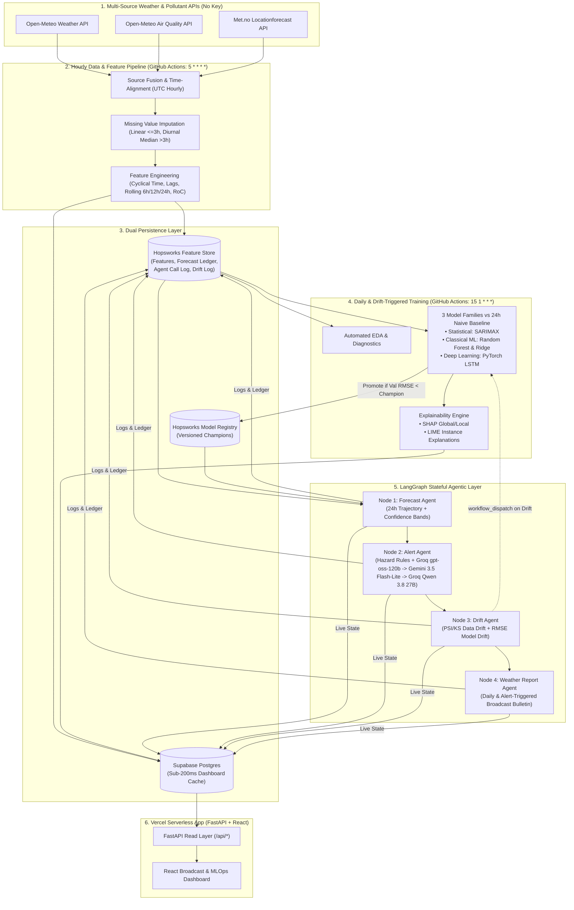
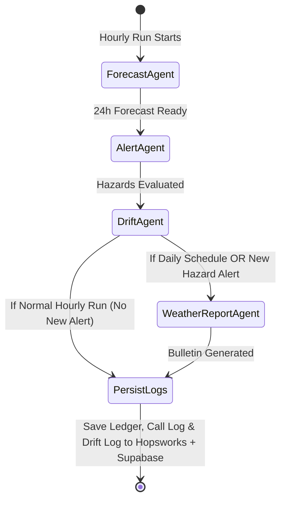

# SkyCast (`AgentWeather`) — End-to-End Implementation Plan

## Goal Description

Build **SkyCast (`AgentWeather`)**, an end-to-end, serverless **Agentic Multi-Metric Weather & Air Quality Forecasting System** for **Lahore, Pakistan** (`31.5204° N, 74.3587° E`), fulfilling 100% of the **10Pearls SHINE Internship Cohort 10** rubric while serving as a standout production MLOps + Agentic AI portfolio piece.

The system ingests hourly weather and pollutant observations from **two zero-key sources** (**Open-Meteo Weather & Air Quality APIs** + **Met.no Locationforecast API**), fuses and time-aligns them, imputes sensor/API gaps, engineers temporal and rolling features, and persists both raw observations and engineered features to **Hopsworks Feature Store** alongside a fast read-replica cache in **Supabase (PostgreSQL)**.

A daily (and drift-triggered) training pipeline evaluates **three distinct model families**—Statistical (`SARIMAX` via `statsmodels`), Classical ML (`RandomForestRegressor` & `Ridge` via `scikit-learn`), and Deep Learning (`LSTM` via CPU `PyTorch`)—against a **24-hour naive persistence baseline** (`RMSE`, `MAE`, `R²`) across all **6 metrics (8 target series)**, promotes champion models to the **Hopsworks Model Registry**, and computes **SHAP** and **LIME** explanations.

On top of the forecasting engine sits a stateful **4-node LangGraph orchestration layer** (**Forecast Agent → Alert Agent → Drift Agent → Weather Report Agent**) powered by **Groq (`openai/gpt-oss-120b`, low reasoning)** as primary LLM with automatic failover to **Gemini Flash-Lite (`gemini-3.5-flash-lite` / configurable `GEMINI_FALLBACK_MODEL`)**, followed by **Qwen 3.8 27B (`qwen-3.8-27b` / configurable `GROQ_TERTIARY_MODEL`, low reasoning)** via the same **Groq API**, and a deterministic rule-based safety net. Every forecast, LLM invocation (prompt, response, latency, status, fallback chain), and drift event (Data Drift via PSI/KS-test + Model Drift via rolling error ratio) is logged to Hopsworks and mirrored to Supabase for sub-200ms delivery via **FastAPI + React on Vercel**.

---

## Tools & Technology Stack

| Layer | Tools & Technology | Role / Short Description |
| :--- | :--- | :--- |
| **Data Sources** | **Open-Meteo + Met.no** | Fetches real-time and historical weather & air-quality data for **Lahore** across all 6 metrics (AQI, Temperature, Precipitation mm & %, Humidity, UV Index, Wind speed & direction) with multi-source fusion and no API key required. |
| **ML & Explainability** | **Python (`statsmodels` SARIMAX, `scikit-learn` Random Forest & Ridge, `PyTorch` CPU LSTM, `SHAP`, `LIME`)** | Performs EDA, feature engineering, 3-family 24h forecasting (vs. 24h naive baseline across `RMSE`, `MAE`, `R²`), and global/local model explainability. |
| **Agentic Layer** | **LangGraph + Groq API (`openai/gpt-oss-120b`, `qwen-3.8-27b` — both low reasoning) + Gemini API (`gemini-3.5-flash-lite`)** | Orchestrates the 4 stateful agents (Forecast, Alert, Weather Report, Drift) using Groq (`openai/gpt-oss-120b`, `reasoning_effort="low"`) as primary LLM with automatic fallback to Gemini 3.5 Flash-Lite, then Qwen 3.8 27B (`reasoning_effort="low"`) via the same Groq API (plus a rule-based safety net) and full call/failure logging. |
| **Feature Store & Registry** | **Hopsworks Serverless (Free Tier)** | Stores engineered features, versioned champion models, Forecast Ledger, Agent Call Log, and Drift Log. |
| **Fast Dashboard Store** | **Supabase (Free PostgreSQL)** | Caches the latest forecasts, weather reports, alerts, EDA, SHAP/LIME outputs, and agent/drift logs from each hourly run so the live dashboard loads in <200ms. |
| **Automation / Pipelines** | **GitHub Actions (Public Repo — \$0)** | Runs the hourly ingestion + agent pipeline, plus daily and drift-triggered (`workflow_dispatch`) model training and SHAP/LIME jobs. |
| **Backend API** | **FastAPI (Vercel Python Serverless — \$0)** | Lightweight `/api/*` read layer inside Vercel serving pre-computed predictions, SHAP/LIME insights, EDA, and agent/drift logs. |
| **Frontend & Hosting** | **React + Tailwind CSS v4 + shadcn/ui + Recharts + Lucide Icons on Vercel (Hobby — \$0)** | Always-on portfolio dashboard built strictly per [skycast-frontend-design.md](file:///d:/SkyCast/skycast-frontend-design.md) (`Barlow Semi Condensed` + `Public Sans`, Light/Dark/System themes, 6 tabs). |
| **Local Dev & Portability** | **Docker (`Dockerfile` + `docker-compose.yml`)** | Lets anyone run the full stack locally in one command (`docker compose up --build`) with zero external cloud setup required for local demo mode. |

---

## User Review Required

> [!IMPORTANT]
> **Locked Architecture Decisions (from `/grill-me` interview)**
> 1. **Target City:** **Lahore, Pakistan** (`lat=31.5204, lon=74.3587, tz=Asia/Karachi`) — chosen for strong seasonal AQI/smog and monsoon dynamics that showcase real Alert and Drift Agent behavior.
> 2. **Multi-Source Fusion (Zero API Key):** Fuses **Open-Meteo** (Weather Forecast/Archive API + Air Quality API) with **Met.no** (Norwegian Meteorological Institute API, no key required) into a single hourly UTC-aligned record using weighted consensus + source-priority fallback.
> 3. **Dual Storage Layer:** **Hopsworks Serverless** (system of record for Feature Groups, Model Registry, Forecast Ledger, Agent Call Log, and Drift Log) + **Supabase Postgres** (low-latency serving cache for the Vercel dashboard).
> 4. **3-Family Forecasting + Explainability:** `SARIMAX` (`statsmodels`) + `Random Forest & Ridge` (`scikit-learn`) + `PyTorch LSTM` vs. `24h Naive Baseline`, with both **SHAP** (global/local feature attributions) and **LIME** (instance-level explanations).
> 5. **LLM Fallback Chain:** Primary **`Groq API (openai/gpt-oss-120b, reasoning_effort="low")`** $\rightarrow$ Secondary **`Gemini Flash-Lite (gemini-3.5-flash-lite)`** $\rightarrow$ Tertiary **`Groq API (Qwen 3.8 27B / qwen-3.8-27b, reasoning_effort="low")`** $\rightarrow$ Final Safety Net **Deterministic Rule-Based Template** (both Groq API models must use low reasoning) so the hourly pipeline never fails even during total API outages.
> 6. **Frontend Specification:** Strictly follows [skycast-frontend-design.md](file:///d:/SkyCast/skycast-frontend-design.md) using **React, Tailwind CSS v4, shadcn/ui, Recharts, Lucide Icons**, and **`Barlow Semi Condensed` + `Public Sans`** typography.

> [!NOTE]
> **Environment Credentials Required During Execution**
> To connect live cloud services when we move to execution, you will only need free-tier credentials in `.env`:
> - `HOPSWORKS_API_KEY` & `HOPSWORKS_PROJECT_NAME`
> - `SUPABASE_URL` & `SUPABASE_SERVICE_ROLE_KEY` (plus `VITE_SUPABASE_URL` / `VITE_SUPABASE_ANON_KEY`)
> - `GROQ_API_KEY` (for primary `openai/gpt-oss-120b` and tertiary fallback `qwen-3.8-27b`)
> - `GEMINI_API_KEY` (for secondary `gemini-3.5-flash-lite` fallback)
> - `GITHUB_TOKEN` & `GITHUB_REPO` (optional locally; used by the Drift Agent to trigger `workflow_dispatch` on GitHub Actions)
> - Our implementation will also include a **Local/Demo Offline Mode** fallback (SQLite/JSON + local artifact registry) so `docker compose up --build` and automated tests work out-of-the-box even before cloud keys are pasted.

---

## System Architecture & LangGraph Workflow



---

## Metrics, Targets & Hazard Alert Thresholds

To satisfy Section 2 of the rubric (*"6 metrics, including mm and rain probability for Precipitation, and speed and direction for Wind"*), the pipeline models **6 core metrics represented as 8 target series**:

| # | Metric Group | Target Column(s) | Unit | Hazard Alert Thresholds & UI Severity (Lahore Calibrated) |
| :--- | :--- | :--- | :--- | :--- |
| 1 | **Air Quality Index** | `us_aqi` | Index (0–500) | **Unhealthy (Sensitive, 101–150):** `Info` \| **Unhealthy (151–200):** `Warning` \| **Very Unhealthy (201–300) / Hazardous (301+):** `Critical` *(US EPA: Good 0–50, Moderate 51–100)* |
| 2 | **Temperature** | `temperature_2m` | °C | **Heatwave Warning (>40°C):** `Warning` \| **Extreme Heat (>44°C) / Cold Wave (<4°C):** `Critical` |
| 3 | **Precipitation** | `precipitation_mm`, `precipitation_prob` | mm/h, % | **Heavy Rain (>7.5 mm/h or Prob >80%):** `Warning` \| **Urban Flood Risk (>15 mm/h):** `Critical` |
| 4 | **Humidity** | `relative_humidity_2m` | % | **Extreme Dry (<15%):** `Info` \| **Muggy/Heat Stress (>85% with Temp >32°C):** `Warning` |
| 5 | **UV Index** | `uv_index` | Index (0–15+) | **High (6–7):** `Info` \| **Very High (8–10):** `Warning` \| **Extreme (≥11):** `Critical` |
| 6 | **Wind** | `wind_speed_10m`, `wind_direction_10m` | km/h, degrees (0–360°) | **Strong Gale/Dust Storm (>40 km/h):** `Warning` \| **Severe Squall (>60 km/h):** `Critical` |

> [!TIP]
> **Circular Wind Direction Handling:** Wind direction (`0–360°`) is decomposed into $\sin(\theta)$ and $\cos(\theta)$ during feature engineering and regression, then reconstructed via $\text{atan2}(\hat{y}_{\sin}, \hat{y}_{\cos}) \pmod{360}$ so transitions across $359^\circ \leftrightarrow 1^\circ$ do not penalize RMSE/MAE artificially.

---

## Proposed Changes

### Component 1: Repository Structure, Configuration & Database Schema

Summary: Establish a clean monorepo layout where Python backend/ML/agent packages live in `skycast/`, FastAPI serverless routes live in `api/`, and the React frontend lives in `web/`.

#### [NEW] `.env.example`
Template for all environment variables (`LAHORE_LAT=31.5204`, `LAHORE_LON=74.3587`, Hopsworks, Supabase, Groq `openai/gpt-oss-120b` & `qwen-3.8-27b`, Gemini `gemini-3.5-flash-lite`, GitHub workflow dispatch).

#### [NEW] `requirements.txt` & `pyproject.toml`
Pinned dependencies split neatly so Vercel serverless (`api/requirements.txt`) stays lightweight (<50MB) while the training/agent pipeline (`requirements-ml.txt`) includes `hopsworks`, `statsmodels`, `scikit-learn`, `torch` (CPU), `shap`, `lime`, `langgraph`, `groq`, `google-genai`, `supabase`, and `scipy`.

#### [NEW] `skycast/config/settings.py`
Central Pydantic settings defining Lahore coordinates, metric definitions, hazard rules, model hyperparameters, and LLM fallback model IDs:
```python
PRIMARY_LLM_PROVIDER = "groq"
PRIMARY_LLM_MODEL = "openai/gpt-oss-120b"
FALLBACK_LLM_PROVIDER = "gemini"
FALLBACK_LLM_MODEL = "gemini-3.5-flash-lite"  # Configurable via GEMINI_FALLBACK_MODEL env var
TERTIARY_LLM_PROVIDER = "groq"
TERTIARY_LLM_MODEL = "qwen-3.8-27b"  # Configurable via GROQ_TERTIARY_MODEL env var (uses same GROQ_API_KEY)
GROQ_REASONING_EFFORT = "low"  # Both Groq API models (openai/gpt-oss-120b & qwen-3.8-27b) must use low reasoning
```

#### [NEW] `supabase/migrations/001_init_skycast.sql`
Creates the fast-serving Postgres tables in Supabase:
- `weather_features_hourly` (latest 14 days of fused observations including `apparent_temperature`, `weather_code`, and pollutants `pm2_5`, `pm10`, `ozone`, `nitrogen_dioxide` + engineered features for EDA, Hero display, and drift charts)
- `forecast_ledger` (every hourly 24h forecast run across all 8 target series: `run_id`, `issued_at_utc`, `target_timestamp_utc`, `horizon_hour` `1..24`, `metric`, `model_family`, `predicted_value`, `lower_bound`, `upper_bound`)
- `model_registry_metrics` (RMSE, MAE, $R^2$ leaderboard for `SARIMAX`, `RandomForest`, `Ridge`, `LSTM`, and `Naive24h` per metric)
- `model_comparison_series` (`train_run_id`, `metric`, aligned test/backtest timestamps, `actual`, and per-model prediction series for `sarimax`, `random_forest`, `ridge`, `lstm`, and `naive_24h`)
- `shap_lime_explanations` (global SHAP importance, local waterfall values, and LIME weights per metric)
- `weather_alerts` (`run_id`, `timestamp`, `metric`, `severity` [`info` | `warning` | `critical`], `title`, `trigger_value`, `threshold`, `advisory_general`, `advisory_sensitive`, `advisory_outdoor_workers`, `is_active`)
- `weather_reports` (editorial news-style bulletins generated daily and upon new alerts)
- `agent_call_log` (`run_id`, `agent_name`, `provider`, `model`, `prompt`, `response`, `latency_ms`, `status`, `fallback_used`, `error_message`)
- `agent_graph_trace` (`run_id`, `node_name`, `step_order`, `status` [`completed` | `skipped` | `failed`], `started_at`, `duration_ms`, `branch_decision`, `summary_json`, `error_message`)
- `drift_log` (`timestamp`, `metric`, `drift_type` [`data_drift` | `model_drift`], `score`, `threshold`, `status` [`no_drift` | `drift_detected` | `check_failed`], `retrain_triggered`, `action_taken`, `error_message`)

---

### Component 2: Data Ingestion, Multi-Source Fusion, Imputation & Backfill Pipeline

Summary: Implements Sections 3 & 4 of the PDF. Fetches Lahore weather & air quality data, fuses Open-Meteo and Met.no, imputes missing values with a documented 3-tier strategy, engineers 35+ temporal and lag/rolling features, and writes to Hopsworks + Supabase.

#### [NEW] `skycast/data/sources/open_meteo.py`
- Fetches hourly weather from `https://api.open-meteo.com/v1/forecast` (and `archive-api.open-meteo.com/v1/archive` for historical backfill): `temperature_2m`, `apparent_temperature`, `weather_code`, `relative_humidity_2m`, `precipitation`, `precipitation_probability`, `uv_index`, `wind_speed_10m`, `wind_direction_10m`, `surface_pressure`, `cloud_cover`.
- Fetches hourly pollutants from `https://air-quality-api.open-meteo.com/v1/air-quality`: `us_aqi`, `pm2_5`, `pm10`, `nitrogen_dioxide`, `ozone`, `sulphur_dioxide`, `carbon_monoxide`.

#### [NEW] `skycast/data/sources/met_no.py`
- Fetches hourly weather from Norwegian Meteorological Institute (`https://api.met.no/weatherapi/locationforecast/2.0/compact?lat=31.5204&lon=74.3587`) with compliant `User-Agent: SkyCast-10Pearls-Portfolio/1.0`.
- Extracts `air_temperature`, `relative_humidity`, `precipitation_amount`, `wind_speed`, `wind_from_direction`, `ultraviolet_index_clear_sky`, and `next_1_hours.summary.symbol_code` (condition fallback; computes Steadman apparent temperature fallback if Open-Meteo is unavailable).

#### [NEW] `skycast/data/fusion.py`
- **Time-Alignment:** Normalizes all timestamps to `UTC` hourly buckets (`YYYY-MM-DD HH:00:00+00:00`).
- **Source Fusion Strategy:**
  - Keeps raw source columns (`temp_openmeteo`, `temp_metno`, etc.) as separate transparency features AND computes a fused canonical metric (`temperature_2m = 0.6 * open_meteo + 0.4 * met_no` when both are present, falling back to whichever source is online if one API times out).
  - Computes `source_disagreement_temp` ($|T_{\text{OM}} - T_{\text{MetNo}}|$) as an uncertainty feature for the ML models.

#### [NEW] `skycast/data/imputation.py`
- **Documented 3-Tier Imputation Strategy** (logged per run for the Technical Report):
  1. **Short sensor/API gaps ($\le 3$ consecutive hours):** Time-aware linear interpolation (`method="time", limit=3`).
  2. **Medium gaps ($4\text{–}24$ hours):** Seasonal diurnal lookback (rolling 7-day median for that exact hour-of-day in Lahore).
  3. **Extended outage ($>24$ hours):** Forward-fill capped with climatological monthly hour median + sets binary flag `is_imputed=1`.

#### [NEW] `skycast/features/engineer.py`
- **Time-Based Features:** `hour_sin`, `hour_cos`, `day_of_week_sin`, `day_of_week_cos`, `month_sin`, `month_cos`, `is_weekend`, `is_lahore_smog_season` (Oct–Feb binary indicator), `is_monsoon_season` (Jul–Sep).
- **Derived & Interaction Features:**
  - **Rate-of-Change (RoC):** 1h, 3h, and 6h first differences ($\Delta_1, \Delta_3, \Delta_6$) for all metrics (e.g., rapid pressure/temperature drop preceding rain or dust storms).
  - **Rolling Statistics:** 6h, 12h, and 24h rolling mean, standard deviation, min, and max.
  - **Historical Lags:** `lag_1h`, `lag_3h`, `lag_6h`, `lag_12h`, `lag_24h`, `lag_48h`.
- **Target Generation (for Training/Backfill):**
  - Shifts observations **1 to 24 hours ahead** (`target_{metric}_t{h} = df[metric].shift(-h)` for `h = 1..24`, with `t+24` as the primary benchmark horizon) so every model outputs full 24h trajectories.
  - As required by Section 4 of the PDF: *"The newest 24 hours have no target yet, so they are used for forecasting only."*

#### [NEW] `skycast/pipelines/backfill.py` & `skycast/pipelines/hourly_ingest.py`
- `backfill.py`: Fetches 90–180 days of historical Lahore data, runs fusion/imputation/feature engineering, and populates the Hopsworks Feature Group (`lahore_weather_features_v1`) and Supabase.
- `hourly_ingest.py`: Runs every hour, appends the newest hourly observation, updates Hopsworks & Supabase, and invokes the LangGraph Agent pipeline.

---

### Component 3: Multi-Family Training, Evaluation, Explainability (SHAP/LIME) & Model Registry

Summary: Implements Sections 5 & 8 of the PDF. Performs automated EDA, trains 3 model families using a strict time-based split, compares all models against the 24h Naive Baseline (`RMSE`, `MAE`, `R²`), runs SHAP & LIME, and promotes winners to the Hopsworks Model Registry.

#### [NEW] `skycast/ml/eda.py`
- Generates structured EDA summaries and JSON plot payloads (distributions, diurnal heatmaps, cross-metric correlation matrix e.g. `PM2.5` vs `Wind Speed` & `Humidity`, seasonal decomposition, and missingness/imputation audit) stored in Supabase and `docs/eda_summary.json` for the Dashboard EDA tab.

#### [NEW] `skycast/ml/models/baseline.py`
- **24h Naive Persistence Baseline:** Predicts $\hat{y}_{t+24} = y_t$ (the exact observation from 24 hours prior). Serves as the benchmark every model family must beat.

#### [NEW] `skycast/ml/models/statistical.py`
- **Statistical Family (`SARIMAX` via `statsmodels`):** Order `(1, 0, 1)x(1, 1, 0, 24)` with top exogenous meteorological predictors; generates `steps=24` trajectories plus native `get_forecast(steps=24).conf_int(alpha=0.2)` (`lower_bound`, `upper_bound`).

#### [NEW] `skycast/ml/models/classical.py`
- **Classical ML Family (`scikit-learn`):**
  - `Ridge` regression (with `StandardScaler` pipeline) trained for multi-horizon `h = 1..24` output with horizon-specific empirical validation residual quantiles for `lower_bound` / `upper_bound`.
  - `RandomForestRegressor` (`n_estimators=200, max_depth=12, min_samples_leaf=4`) configured for direct multi-horizon (`h = 1..24`) hourly curve estimation with tree-variance / empirical validation residual intervals.

#### [NEW] `skycast/ml/models/deep_learning.py`
- **Deep Learning Family (`PyTorch LSTM`):**
  - Lightweight 2-layer `WeatherLSTM` (`input_size=n_features, hidden_size=64, num_layers=2, dropout=0.2`, 24-step output head) trained on 24-hour lookback sequences with EarlyStopping on CPU and conformal/empirical validation residual quantiles for `lower_bound` / `upper_bound`.

#### [NEW] `skycast/ml/evaluate.py` & `skycast/ml/explain.py`
- **Time-Based Split:** Chronological 70% Train / 15% Validation / 15% Test split (zero data leakage; no random shuffling).
- **Metrics Computed per Target:** `RMSE`, `MAE`, and `R²` on Validation and Test sets, plus `% Improvement over 24h Naive Baseline`, and persists aligned test/backtest predictions per model (`SARIMAX`, `RandomForest`, `Ridge`, `LSTM`, `Naive24h`) to `model_comparison_series`.
- **Champion Promotion Rule:** Queries the current production model's validation `RMSE` from Hopsworks Model Registry (`lahore_{metric}_champion`). Only uploads and promotes the new model if `new_val_rmse < current_champion_val_rmse` (and beats the Naive Baseline).
- **SHAP & LIME Explainability (`explain.py`):**
  - Computes **SHAP** values (`shap.TreeExplainer` for Random Forest, `shap.LinearExplainer` for Ridge, `shap.KernelExplainer` for LSTM/SARIMAX) to extract top 10 global features and local waterfall contributions for the latest forecast.
  - Computes **LIME** (`lime.lime_tabular.LimeTabularExplainer`) local explanations for the current 24h forecast instance so users can toggle between SHAP and LIME on the dashboard.

---

### Component 4: Stateful LangGraph Agentic Layer (4 Agents + Groq $\rightarrow$ Gemini $\rightarrow$ Qwen Fallback)

Summary: Implements Section 6 of the PDF. All 4 agents are nodes inside a single compiled `StateGraph(AgentWeatherState)` sharing state persisted to the Forecast Ledger between runs.



#### [NEW] `skycast/agents/llm_client.py`
- Unified resilient LLM wrapper with full telemetry logging:
  1. **Primary Call:** Calls **Groq API** (`model="openai/gpt-oss-120b"`, `reasoning_effort="low"`, timeout=15s). Records `latency_ms`, `prompt`, `response`, `status="success"`.
  2. **Automatic Fallback 1 (Secondary LLM — Gemini):** On RateLimit, Timeout, or 5xx error, logs the failed Groq call to the **Agent Call / Failure Log** (`status="failed"`, `error_message=...`) and immediately retries with **Gemini API (`gemini-3.5-flash-lite`)** via `google-genai`.
  3. **Automatic Fallback 2 (Tertiary LLM — Groq Qwen):** If Gemini also fails or times out, logs the failed Gemini call to the **Agent Call / Failure Log** and immediately retries with **Qwen 3.8 27B (`qwen-3.8-27b`)** (`reasoning_effort="low"`) via the same **Groq API** (`GROQ_API_KEY`). Both Groq API models must always pass `reasoning_effort="low"`.
  4. **Automatic Fallback 3 (Deterministic Template):** If all three cloud LLM models are unreachable, logs the third failure and synthesizes a deterministic structured meteorological alert/report from the numerical forecast so the pipeline never crashes.

#### [NEW] `skycast/agents/state.py` & `skycast/agents/graph.py`
- Defines `AgentWeatherState(TypedDict)` holding: `run_id`, `timestamp_utc`, `city`, `latest_features`, `forecasts_24h` (hourly trajectory `h=1..24` with `lower_bound`/`upper_bound` + T+24 point), `champion_models_used`, `triggered_hazards`, `alerts_payload`, `drift_results`, `retrain_triggered`, `weather_report`, `llm_call_logs`, and `graph_trace`.
- Defines the 4 LangGraph nodes (each recording entry/exit timings, status, and branch decisions to `agent_graph_trace`):
  1. **`forecast_node` (`Forecast Agent`):** Loads latest engineered features and champion models from Hopsworks/cache, generates the next 24 hours of predictions (`h=1..24`) plus `lower_bound`/`upper_bound` confidence intervals for all 6 metrics (8 series), logs to `Forecast Ledger`, and passes predictions downstream.
  2. **`alert_node` (`Alert Agent`):** Evaluates deterministic hazard rules across all 6 metrics mapped to `info` / `warning` / `critical` (e.g. US EPA AQI `101–150` Info, `151–200` Warning, `201+` Critical; Temp > 40°C; Wind > 40 km/h; UV $\ge$ 6; Rain > 7.5 mm/h). When triggered, invokes the LLM (`Groq openai/gpt-oss-120b` $\rightarrow$ `Gemini 3.5 Flash-Lite` $\rightarrow$ `Groq Qwen 3.8 27B`) to write plain-titled alerts and structured, actionable advisories tailored to three distinct audiences:
     - **General Public**
     - **Sensitive Groups** (children, elderly, asthma/respiratory patients)
     - **Outdoor Workers** (construction, delivery riders, traffic wardens)
  3. **`drift_node` (`Drift Agent`):**
     - **Data Drift:** Compares the recent 48-hour live feature window against the training baseline distribution using **Population Stability Index (PSI)** and the **Two-Sample Kolmogorov-Smirnov (KS) test** (drift threshold: $\text{PSI} > 0.25$ or $p < 0.01$).
     - **Model Drift:** Compares realized 24h forecast `RMSE` over the last 72 hours (by joining past `Forecast Ledger` predictions with actual observed values) against the champion model's validation `RMSE` (drift threshold: $\text{Live RMSE} > 1.35 \times \text{Val RMSE}$).
     - **Action:** Logs every check to the `Drift Log` with explicit status (`no_drift`, `drift_detected`, or `check_failed` with `error_message` on missing baseline, insufficient sample window, or dispatch failure). When drift crosses the threshold, triggers an automated retraining run via GitHub Actions REST API (`POST /repos/{owner}/{repo}/actions/workflows/train.yml/dispatches`) or local background runner.
  4. **`weather_report_node` (`Weather Report Agent`):** Runs on the daily 06:xx PKT schedule (`local_time.hour == 6`, matching the `01:05 UTC` / `06:05 PKT` hourly run) AND whenever `alert_node` triggers a new hazard alert. Synthesizes the 24h forecast trajectory, active alerts, and SHAP drivers into an engaging, broadcast-grade **Lahore Weather & Air Quality News Report**.

---

### Component 5: Backend API (`FastAPI` on Vercel Serverless)

Summary: Lightweight read-only API inside `api/index.py` serving cached state from Supabase (with automatic local JSON fallback for offline Docker demos).

#### [NEW] `api/index.py` & `vercel.json`
FastAPI application exposing:
- `GET /api/health` — Pipeline heartbeat, last ingestion timestamp, active storage mode.
- `GET /api/dashboard/overview` — Single consolidated payload for initial page load (current Lahore conditions including `apparent_temperature`, `weather_code`, and pollutants `pm2_5`/`pm10`/`ozone`/`nitrogen_dioxide`, the last `24` observed hours `observed_24h` for stat-card sparklines and the `"Now"` chart lead-in, 24h forecasts `h = 1..24` with `lower_bound`/`upper_bound` for all 6 metrics, latest news-style weather report, and active alerts with `severity`).
- `GET /api/forecasts/history` — Forecast vs. Actual comparison + 24h Naive Baseline overlay + confidence bounds.
- `GET /api/models/leaderboard` — Validation & Test `RMSE`, `MAE`, `R²` across `SARIMAX`, `RandomForest`, `Ridge`, `PyTorch LSTM`, and `Naive Baseline`, aligned per-model `comparison_series`, plus **SHAP** & **LIME** feature explanations.
- `GET /api/eda/summary` — Pre-computed EDA distributions, diurnal profiles, correlation matrix, and imputation statistics.
- `GET /api/agents/logs` — Full **Agent Call Log**, **Failed Calls / Fallback Log**, **Drift Log** (including `check_failed` status), and **LangGraph execution trace** (`agent_graph_trace`).
- `GET /api/report` — Serves `docs/FINAL_REPORT.md` markdown content and `updated_at` timestamp (with `vercel.json` routing `/api/*` to FastAPI, bundling `docs/FINAL_REPORT.md`, and serving `web/dist` for the SPA).

---

### Component 6: Frontend Dashboard (`React` + `Tailwind CSS v4` + `shadcn/ui` + `Recharts` + `Lucide Icons`)

Summary: The frontend implementation will strictly follow [skycast-frontend-design.md](file:///d:/SkyCast/skycast-frontend-design.md) for all design principles, color tokens (`Sky Slate` Light/Dark/System modes via CSS variables in `web/src/index.css`), typography (`Barlow Semi Condensed` + `Public Sans`), spacing/radius hierarchy, accessibility rules, Recharts styling, and the 6-tab responsive navigation shell (`Overview`, `Forecasts`, `Models`, `EDA`, `Agents and drift`, and `Technical report`).

#### [NEW] `web/` Application Files (Built per [skycast-frontend-design.md](file:///d:/SkyCast/skycast-frontend-design.md))
- `web/index.html`, `web/src/main.tsx`, `web/src/index.css`, & `web/src/App.tsx` — Google Fonts (`Barlow Semi Condensed` + `Public Sans`), anti-FOUC theme script, exact Sky Slate CSS token system, existing Vite shadcn `ThemeProvider`, and `react-markdown` + `remark-gfm` + required shadcn UI primitives (`card`, `tabs`, `badge`, `table`, `dropdown-menu`, `sheet`, `tooltip`, `select`).
- `web/src/lib/aqi.ts`, `web/src/lib/time.ts`, & `web/src/lib/weather.ts` — US EPA AQI helper, PKT (`Asia/Karachi`) formatting with UTC tooltip strings, and WMO `weather_code` label/icon mapping.
- `web/src/components/theme-toggle.tsx` & `web/src/components/app-shell.tsx` — Responsive 248px/72px sidebar, mobile bottom nav + sheet, and header with city status & refresh.
- `web/src/components/shared/` — Reusable UI primitives: `aqi-gauge.tsx` (semicircle gauge + level badge/icon), `wind-compass.tsx`, `sparkline.tsx`, `chart-card.tsx` (`aria-label` + `"Show as table"` toggle), `alert-banner.tsx` (4px severity edge + icon), `advisory-cards.tsx` (3-column audience cards), and `timestamp-pkt.tsx` (PKT readout + hover/focus UTC tooltip).
- `web/src/components/tabs/overview-tab.tsx` — Alert banner, Hero current-conditions panel (`temperature`, `feels like`, `condition`, wind compass), semicircle AQI gauge + pollutants (`PM2.5`, `PM10`, `O3`, `NO2`), 6 metric stat cards with 24h diurnal sparklines (`observed_24h`), 24h forecast chart (slicing the last `12h` observed lead-in + `24h` forecast around the `"Now"` marker, with confidence band), weather bulletin, and 3-column audience advisories.
- `web/src/components/tabs/forecasts-tab.tsx` — Metric selector tabs, full-width trajectory chart (`24h` observed + `24h` forecast around `"Now"` with `12h / 24h` lookback toggle and confidence band), forecast vs. actual history with 24h Naive Baseline overlay, and accessible `"Show as table"` toggle.
- `web/src/components/tabs/models-tab.tsx` — Validation/Test leaderboard (`RMSE`, `MAE`, `R²`, `% improvement over naive`), model family comparison chart, and segmented `SHAP` / `LIME` explanation view.
- `web/src/components/tabs/eda-tab.tsx` — Distributions, diurnal heatmap, correlation matrix, seasonal decomposition, and imputation audit table.
- `web/src/components/tabs/agents-drift-tab.tsx` — Sub-tabs for Agent Call Log, Failed Calls & Fallbacks (`Groq openai/gpt-oss-120b` $\rightarrow$ `Gemini 3.5 Flash-Lite` $\rightarrow$ `Groq Qwen 3.8 27B`), Drift Log (`no_drift`, `drift_detected`, `check_failed`), and LangGraph trace (`agent_graph_trace`) with filters.
- `web/src/components/tabs/technical-report-tab.tsx` — 800px centered reader fetching `GET /api/report`, rendering `FINAL_REPORT.md` via `react-markdown` + `remark-gfm` with horizontally scrollable tables, sticky table of contents, and `"Download report"` `.md` download button.

---

### Component 7: CI/CD Automation (`GitHub Actions`), `Docker` Portability & Final Submission Report

Summary: Implements Section 7 & Section 9 of the PDF plus the portfolio portability requirement.

#### [NEW] `.github/workflows/hourly_pipeline.yml`
- **Schedule:** `cron: '5 * * * *'` (every hour) + `workflow_dispatch`.
- **Steps:** Fetches Open-Meteo + Met.no data for Lahore $\rightarrow$ fuses & imputes $\rightarrow$ computes features $\rightarrow$ writes to Hopsworks & Supabase $\rightarrow$ runs the LangGraph Agent pipeline (`Forecast` $\rightarrow$ `Alert` $\rightarrow$ `Drift` $\rightarrow$ conditional `Weather Report`).

#### [NEW] `.github/workflows/training_pipeline.yml`
- **Schedule:** `cron: '15 1 * * *'` (daily at 06:15 PKT) + `workflow_dispatch` (triggered automatically by the **Drift Agent** when data or model drift crosses its threshold).
- **Steps:** Pulls historical feature store data $\rightarrow$ runs EDA $\rightarrow$ trains `SARIMAX`, `RandomForest`, `Ridge`, and `PyTorch LSTM` vs `24h Naive Baseline` $\rightarrow$ promotes winning models to Hopsworks Model Registry $\rightarrow$ generates SHAP & LIME explanations $\rightarrow$ updates Supabase cache.

#### [NEW] `Dockerfile` & `docker-compose.yml`
- Multi-service `docker-compose.yml` allowing any reviewer or recruiter to run `docker compose up --build` in one command to launch the FastAPI backend, React frontend, and local pipeline scheduler.

#### [NEW] `docs/FINAL_REPORT.md` & `README.md`
- **Comprehensive 10Pearls Final Technical Report (`docs/FINAL_REPORT.md`)** covering:
  1. Multi-source fusion (`Open-Meteo` + `Met.no`) and time-alignment mechanics.
  2. Documented 3-tier missing data imputation strategy and audit metrics.
  3. EDA insights for Lahore's 6 weather & AQI metrics.
  4. Model architecture choices, time-based validation results (`RMSE`, `MAE`, `R²` vs. 24h Naive Baseline), and SHAP/LIME interpretability findings.
  5. Issues encountered and engineering fixes applied.
  6. Agentic layer performance analysis: Alert quality across the 3 public/worker groups, Data & Model Drift detection sensitivity, and LLM call failure/fallback resilience (`Groq openai/gpt-oss-120b` $\rightarrow$ `Gemini 3.5 Flash-Lite` $\rightarrow$ `Groq Qwen 3.8 27B`).

---

## Verification Plan

### Automated Tests
We will create a complete `pytest` suite under `tests/` and verify every layer:
1. **Data Fusion, Imputation & Feature Engineering Tests:**
   ```powershell
   pytest tests/test_data_pipeline.py -v
   ```
   Verifies UTC timestamp alignment between Open-Meteo and Met.no, 3-tier gap imputation accuracy, circular wind encoding ($\sin/\cos$), and 24-hour target shifting without future leakage.
2. **3-Family ML & SHAP/LIME Explainability Tests:**
   ```powershell
   pytest tests/test_ml_pipeline.py -v
   ```
   Verifies that `SARIMAX`, `RandomForest`, `Ridge`, and `PyTorch LSTM` train on time-split data, compute `RMSE`/`MAE`/`R²` against the 24h Naive Baseline, output valid SHAP and LIME explanations, and obey the Champion Promotion rule.
3. **LangGraph Agents, Drift Detection & LLM Fallback Tests:**
   ```powershell
   pytest tests/test_agents.py -v
   ```
   Verifies the 4-node LangGraph execution order, hazard threshold alerting for all 3 target audiences, PSI/KS data drift + RMSE model drift triggers, `reasoning_effort="low"` configuration on both Groq API models, and forced failure testing of `Groq (openai/gpt-oss-120b)` automatically failing over to `Gemini 3.5 Flash-Lite` and then to `Groq (Qwen 3.8 27B)` while recording each failed attempt in the Agent Failure Log.
4. **FastAPI + React Production Build Verification:**
   ```powershell
   pytest tests/test_api.py -v
   cd web; npm run build
   ```

### Manual Verification
1. **End-to-End Local Pipeline Run:** Run `python -m skycast.pipelines.backfill --days 30` followed by `python -m skycast.pipelines.train` and `python -m skycast.pipelines.hourly_ingest` to populate realistic Lahore weather forecasts, SHAP/LIME charts, alerts, and drift logs.
2. **Live Dashboard Inspection:** Start the app locally (and inspect in the browser) to verify all 5 rubric tabs + the Technical Report tab render cleanly with zero console errors.
3. **Docker One-Command Check:** Verify `docker compose config` and container startup.
